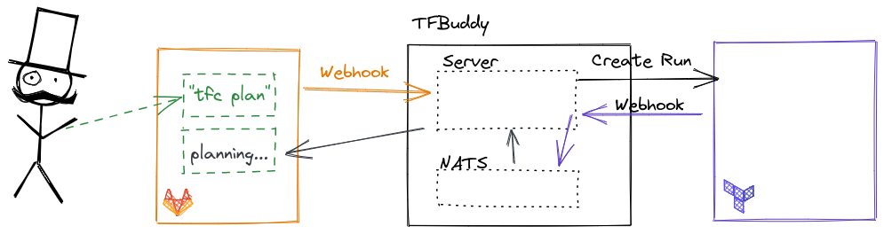
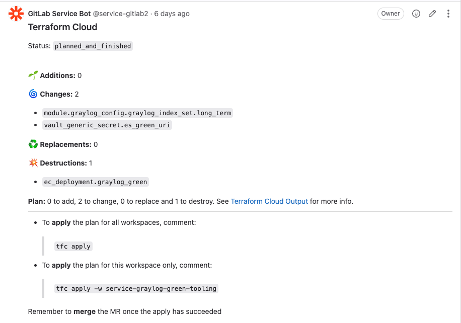
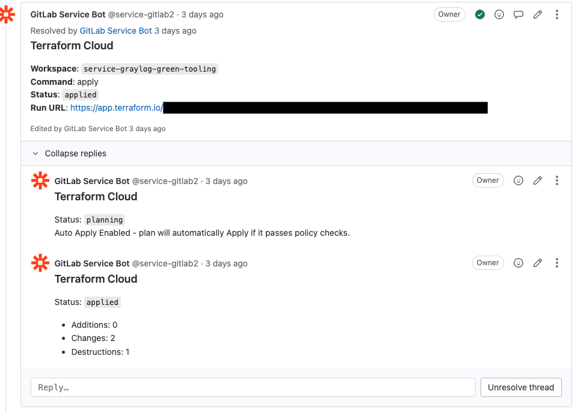
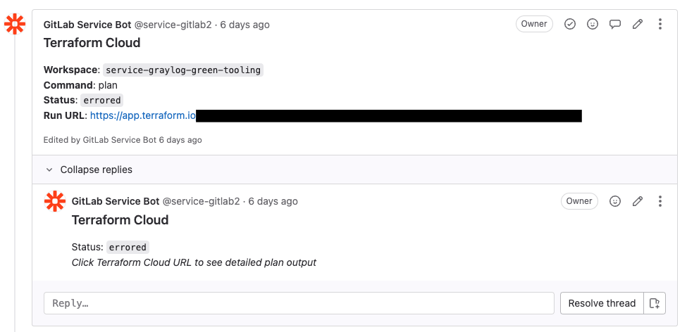

# Architecture

TF Buddy is driven by different webhook events from either a Terraform Cloud workspace, or a supported VCS (Github/Gitlab). These events are either user commands in the form of comments, or changes in state (PR being opened/closed).

## Overview



Once you have TF Buddy deployed you need to register a webhook from each repo that you want TF Buddy to operate on. You also need to register a webhook from each Terraform Workspace that you want TF Buddy to interact with. Once that's configured TF buddy will kick into action when you open a new PR. TF Buddy will then execute a speculative plan against the branch and will report back the plan in a detailed manner.



If you're happy with the plan you can issue a apply command `tfc apply` or if you're operating on multiple workspaces you can target a specific workspace `tfc apply -w workspace_name`. TF Buddy will verify that the PR is approved if that's required on your repo. It will also reject any applies if the branch has conflicts. Once the apply starts TF Buddy will provide a link to the run in Terraform Cloud for you to follow along with.



Once the apply completes TF Buddy will update the PR indicating what was changed and if there was any errors.

#### Comment Cleanup

When `TFBUDDY_DELETE_OLD_COMMENTS` is set, TFBuddy automatically cleans up old discussion threads to keep MRs/PRs readable. Each comment is tagged with an invisible HTML marker identifying its workspace and action (plan or apply). When a new run completes, TFBuddy deletes older discussions that match the same workspace and action, keeping only the latest one. This is workspace-scoped: if your MR triggers runs in multiple workspaces, each workspace retains its own most recent plan and apply comment independently. Previous run URLs are collected into a collapsible "Previous TFC Urls" table on the latest comment.

Example of how an error is reported



A more detailed error message is provided if the error occurred within TF Buddy. If the error occurred during terraform plan or terraform apply it will not contain a detailed message. Instead the run link will take you to the Terraform workspace where you can debug the error.


### Long-running hook events

When an MR/PR touches several Terraform workspaces, the hook worker that handles the event clones the repository once, evaluates which workspaces are blocked by changes on the target branch, and then triggers a run for each remaining workspace from that clone, one after another.

The hook workers read their queues through JetStream pull consumers: `gitlab_mr_event_pull_worker`, `gitlab_note_event_pull_worker` and `github_comment_event_pull_worker` on the `HOOKS` stream. Each replica pulls one event, handles it, and only then pulls the next, so a burst of merge requests waits in the stream and the next free replica takes the next event. While an event is handled, TFBuddy extends its ack deadline every 20s, so an MR that takes minutes to plan is not handed to another replica to plan again. The consumers use a 60s `AckWait`, which only bounds how long a crashed replica holds an event, and at most 5 deliveries. A handler error retries after 30s; a permanent error, a panic or an undecodable message is dropped.

On startup TFBuddy deletes the push consumers older releases used (`gitlab_mr_event_worker`, `gitlab_note_event_worker`, `github_comment_event_worker`), because a work-queue stream allows one consumer per subject. Events they had not acked stay in the stream and go to the pull consumers. Once that has happened, an older release cannot create its push consumers again, so rolling back needs the pull consumers deleted first, for example `nats consumer rm HOOKS gitlab_mr_event_pull_worker`, and the same for the other pull consumers.

Releases v0.5.0 to v0.8.5 could instead publish one message per workspace to a `TFBUDDY_WORKSPACE_TRIGGERS` stream (`TFBUDDY_WORKSPACE_FANOUT_ENABLED`, on by default). TFBuddy no longer creates or reads that stream. Once no older release is running, delete it with `nats stream rm TFBUDDY_WORKSPACE_TRIGGERS`.

Each workspace dispatch is also recorded in the `WORKSPACE_DISPATCHES` KV bucket, keyed by the webhook delivery ID (or the GitLab note ID) and the workspace, for 2 hours. When a hook event is delivered again anyway, after a crash for example, the workspaces it already dispatched are skipped instead of planned a second time. A new push or `tfc plan` comment is a new trigger and always runs. The metrics `tfbuddy_jetstream_messages_settled` and `tfbuddy_jetstream_messages_redelivered` show how each queue's messages end and how often they are redelivered.

### Run events and polling

Run status events (`RUN_EVENTS`) and polling tasks (`RUN_POLLING`) go through the same kind of pull consumer: `gitlab_run_event_pull_worker` and `github_run_event_pull_worker` on `RUN_EVENTS`, and `run_polling_pull_worker` on `RUN_POLLING`. Each replica handles one message at a time, with the same ack deadline, retry and metrics behaviour as the hook queues. Older releases read these streams through push consumers that redelivered an event whenever it waited in a busy replica's buffer for more than 30s, so the same status was often handled several times, sometimes long after the run had finished.

A run event that the handler does not handle, for example because the TFC API call failed, is retried after 30s, at most 5 deliveries in all. A failed poll is not redelivered: the task goes back to the polling KV with its usual 10s delay, and the dispatcher sends it again from there.

On startup TFBuddy deletes the push consumers older releases used on these streams (`gitlab`, `github` and `polling`). Rolling back to such a release needs the pull consumers deleted first:

```
nats consumer rm RUN_EVENTS gitlab_run_event_pull_worker
nats consumer rm RUN_EVENTS github_run_event_pull_worker
nats consumer rm RUN_POLLING run_polling_pull_worker
```

### TFC API Rate Limiter

The TFC API client wraps its HTTP transport with a token-bucket rate limiter (`TFBUDDY_TFC_RATE_LIMIT_RPS`, default `30`; burst `TFBUDDY_TFC_RATE_LIMIT_BURST`, default `30`) so concurrent hook workers cooperatively stay under TFC's documented per-token limit. The client deliberately has no top-level `Timeout`: `ConfigurationVersions.Upload` streams the cloned repo and a fixed cap would truncate slow uploads on large repos. Per-call deadlines flow through `context.Context`.

### Webhook Management

At Zapier we automate the creation of all relevant webhooks by leveraging Terraform to create them. The example below is a resource we use to hook up a Gitlab project and a Terraform Cloud workspace to TF Buddy.

```terraform
resource "gitlab_project_hook" "tfbuddy" {

  project = "project"
  url     = var.tfbuddy_gitlab_webhook_url

  enable_ssl_verification = true

  merge_requests_events = true
  note_events           = true
  push_events           = true

  token = var.tfbuddy_gitlab_webhook_token
}

resource "tfe_notification_configuration" "tfbuddy" {

  name             = "tfbuddy"
  enabled          = true
  destination_type = "generic"
  triggers = [
    "run:created",
    "run:planning",
    "run:errored",
    "run:needs_attention",
    "run:applying",
    "run:completed"
  ]
  url          = var.tfbuddy_tfc_webhook_url
  workspace_id = "workspace_id"
}

```

